# Terraform Provisioners Project – AWS EC2 Flask Application Deployment

## Project Overview

This project demonstrates how to use Terraform Provisioners to automate AWS infrastructure provisioning and deploy a Python Flask application on an Ubuntu EC2 instance.

In this project, I used:
- **File Provisioner** to transfer the Flask application from my local machine to EC2.
- **Remote-Exec Provisioner** to install dependencies and start the Flask application remotely.
- **SSH Connection** to connect Terraform to the EC2 instance.

## Project Architecture

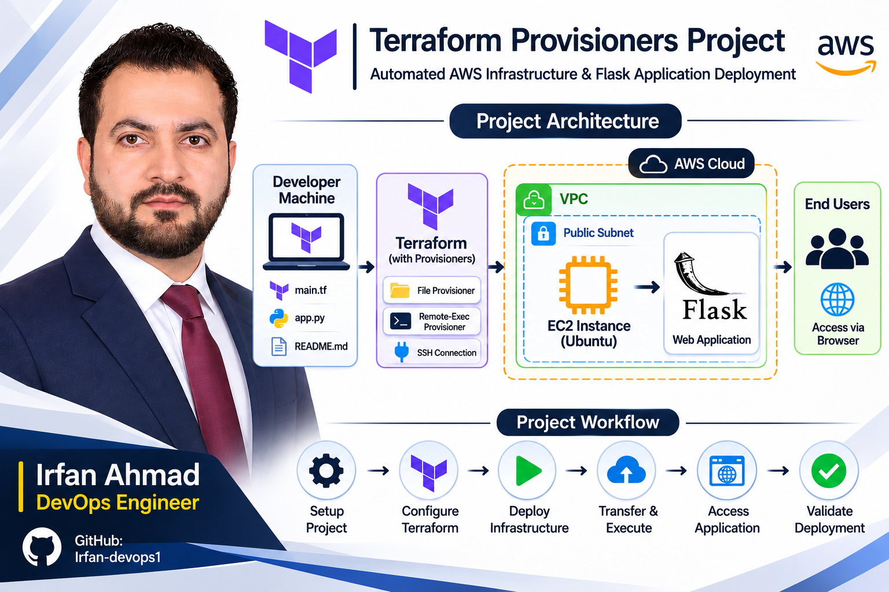

## Technologies Used

- Terraform
- AWS EC2
- AWS VPC
- AWS Subnet
- Internet Gateway
- Route Table
- Security Group
- Ubuntu Linux
- Python
- Flask
- SSH
- Git and GitHub

---

## Project Implementation Workflow

### Step 1: Project Folder Structure

Organized the project repository with Terraform configuration files, Flask application code, documentation, Git ignore rules, and implementation evidence.

**Project Repository Structure:**

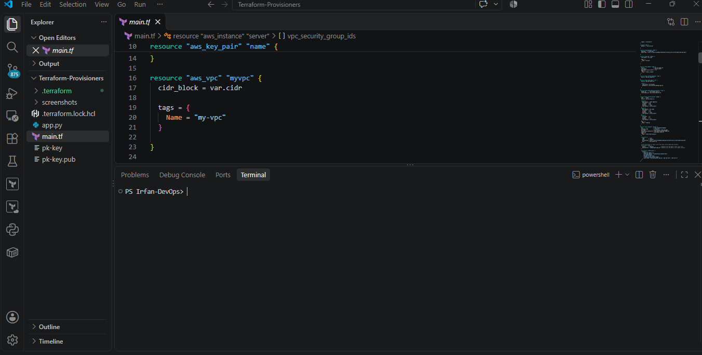

### Step 2: Terraform Configuration

Configured the AWS provider and infrastructure resources, including VPC, public subnet, Internet Gateway, route table, security group, key pair, and EC2 instance.

**Infrastructure as Code (IaC) Configuration:**

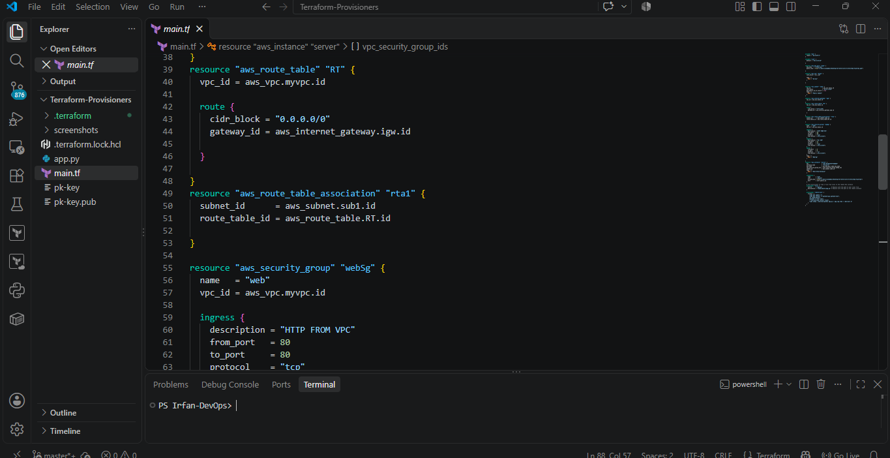

### Step 3: Flask Application

Created a Python Flask application to display a success message when accessed through a web browser.

**Application Source Code:**

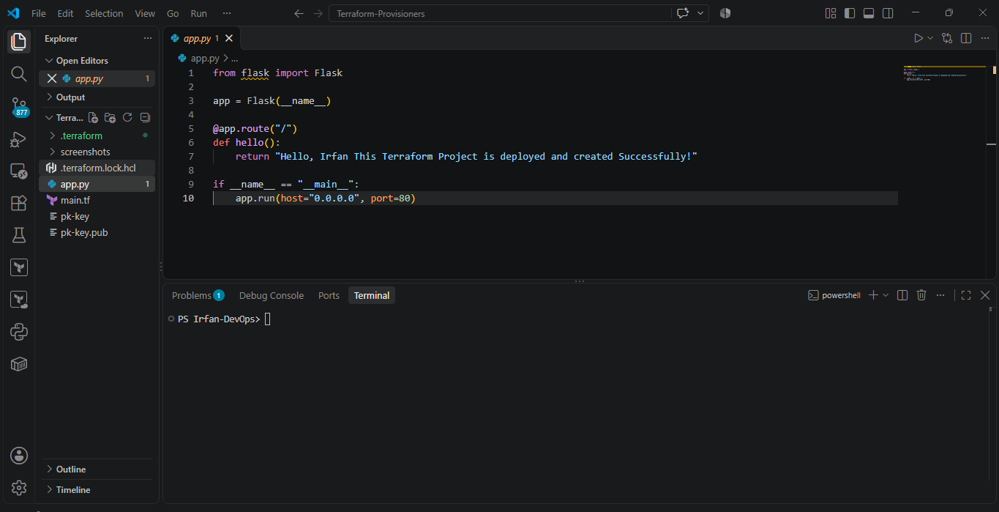

### Step 4: Terraform Initialization

Initialized the Terraform working directory and downloaded the required AWS provider.

**Command:**

```bash
terraform init
```

**Terraform Initialization Output:**

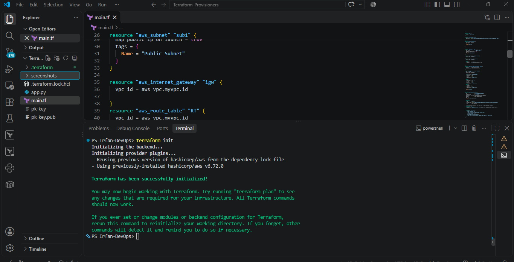

### Step 5: Terraform Validation

Validated the Terraform configuration to check for syntax and configuration errors.

**Command:**

```bash
terraform validate
```

**Configuration Validation Results:**

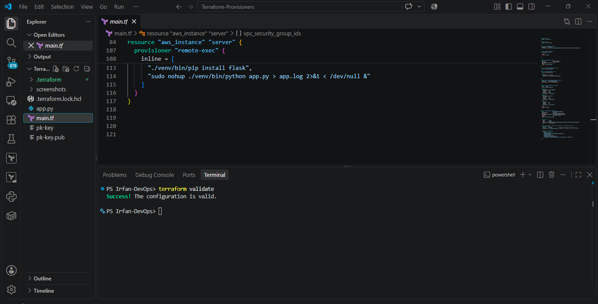

### Step 6: Terraform Plan

Reviewed the execution plan to understand which AWS resources Terraform would create.

**Command:**

```bash
terraform plan
```

**Infrastructure Execution Plan:**

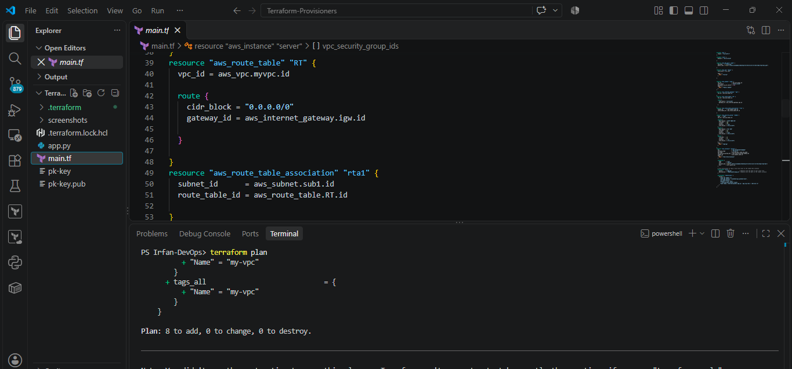

### Step 7: Terraform Apply

Applied the Terraform configuration to create AWS infrastructure and deploy the application.

**Command:**

```bash
terraform apply
```

**Infrastructure Deployment Results:**

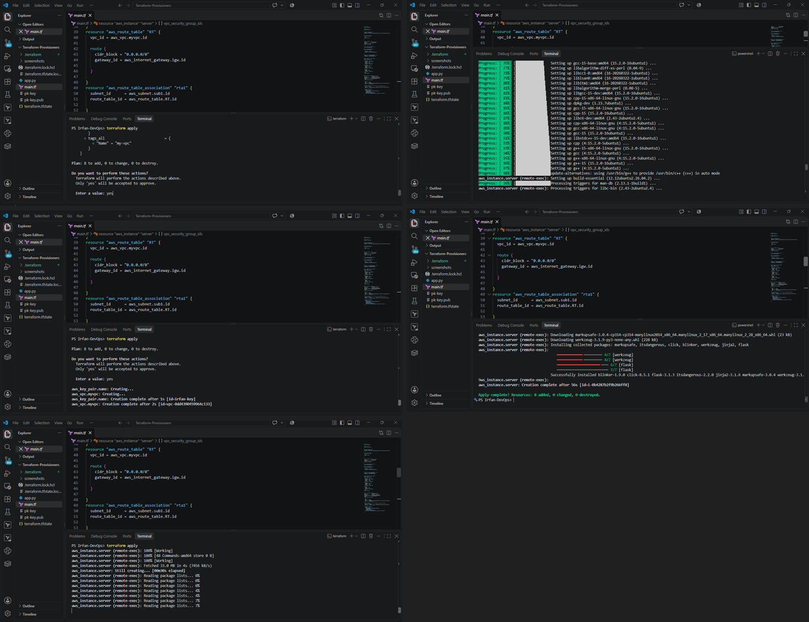

### Step 8: AWS EC2 Instance Creation

Verified that the EC2 instance was successfully created in the AWS Management Console.

**AWS EC2 Resource Provisioning:**

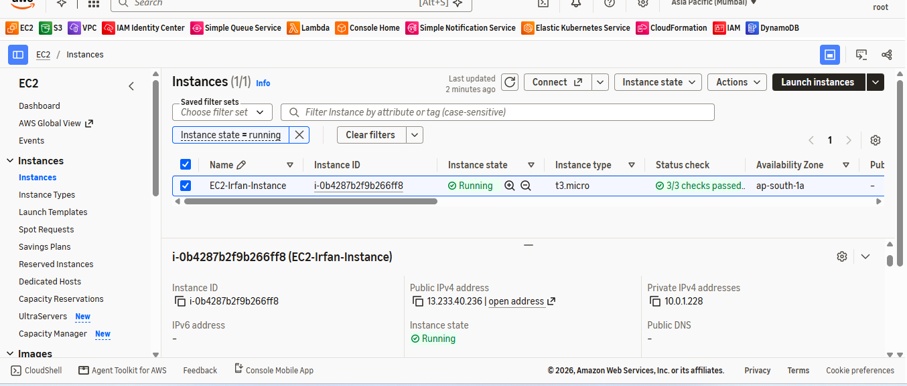

### Step 9: File Provisioner

Used the Terraform File Provisioner to transfer the local `app.py` file to the EC2 instance.

**Terraform Configuration:**

```hcl
provisioner "file" {
  source      = "app.py"
  destination = "/home/ubuntu/app.py"
}
```

**File Provisioner – Transfer Verification:**

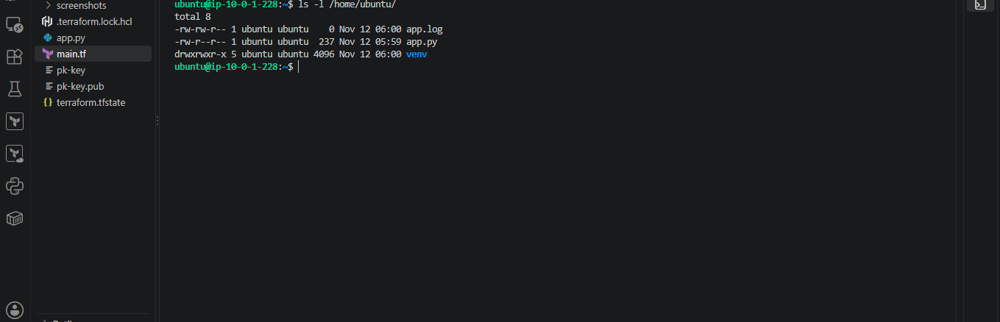

### Step 10: Remote-Exec Provisioner

Used the Remote-Exec Provisioner to execute commands remotely on the EC2 instance.

Tasks performed:

- Updated Ubuntu packages.
- Installed Python and pip.
- Created a Python virtual environment.
- Installed Flask.
- Started the Flask application.

**Remote-Exec Provisioner – Configuration Execution:**

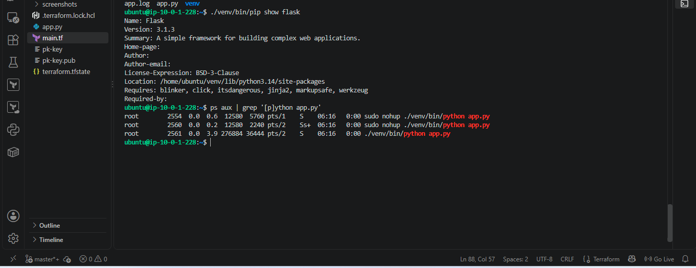

### Step 11: Flask Application in Browser

Accessed the deployed Flask application using the EC2 instance's public IPv4 address.

**Application URL:**

```text
http://<EC2-PUBLIC-IP>
```

**Application Deployment – Browser Verification:**

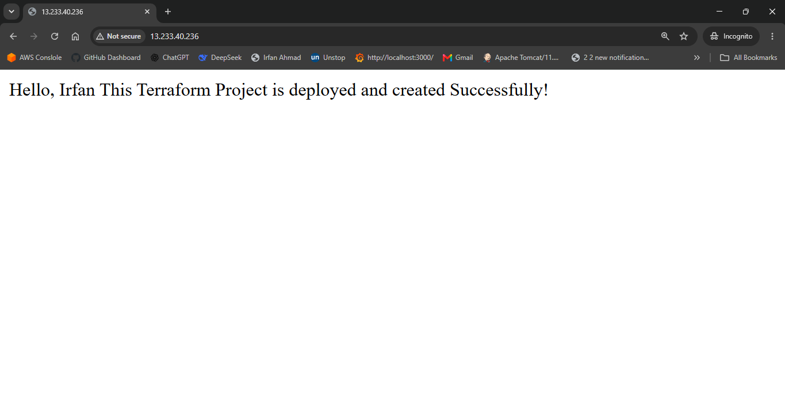

### Step 12: Application Verification

Verified that the Flask application was running successfully on the EC2 instance.

**Command:**

```bash
curl http://localhost
```

**Expected Output:**

```text
Hello, Irfan This Terraform Project is deployed and created Successfully!
```

**Application Runtime Validation:**

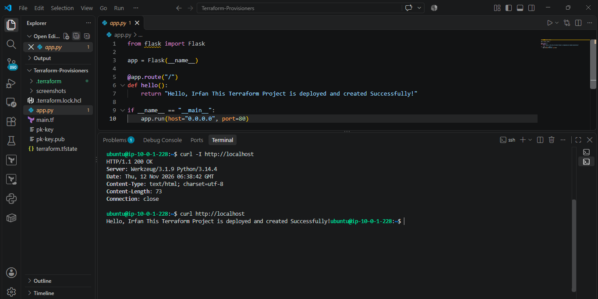

---

## AWS Resources Created

| AWS Resource | Purpose |
|---|---|
| VPC | Creates an isolated AWS network |
| Public Subnet | Hosts the EC2 instance |
| Internet Gateway | Provides internet connectivity |
| Route Table | Routes internet traffic |
| Route Table Association | Associates the route table with the subnet |
| Security Group | Controls inbound traffic |
| Key Pair | Enables SSH authentication |
| EC2 Instance | Hosts the Flask application |

## Terraform Provisioners Used

### 1. File Provisioner
Transfers application files from the local machine to the remote EC2 instance.

### 2. Remote-Exec Provisioner
Executes remote commands over SSH to install dependencies and start the Flask application.

### 3. Connection Block
Establishes SSH connectivity between Terraform and the EC2 instance.

## Key Learnings

- Provisioning AWS infrastructure using Terraform.
- Understanding Terraform File Provisioners.
- Executing remote commands using Remote-Exec Provisioners.
- Configuring SSH connections to EC2 instances.
- Deploying Python Flask applications on Ubuntu.
- Automating application deployment.

## Security Considerations

- Never upload private SSH keys to GitHub.
- Never upload Terraform state files.
- Keep AWS credentials secure.
- Restrict SSH access to trusted IP addresses instead of allowing unrestricted access.

## Cleanup

To destroy the AWS resources created by this project, run:

```bash
terraform destroy
```

Confirm the operation when prompted.

## Author
**Irfan Ahmad**  
DevOps Engineer

---
- **Project Repository:** [Terraform Provisioners Project](https://github.com/Irfan-devops1/terraform-provisioners-project)

- **GitHub Profile:** [Irfan-devops1](https://github.com/Irfan-devops1)


**Project:** Terraform Provisioners – AWS EC2 Flask Application Deployment